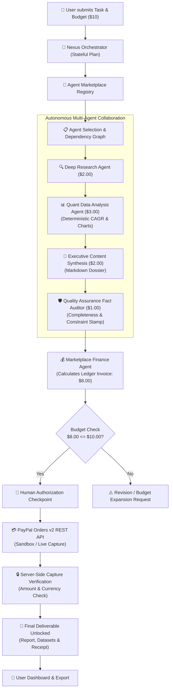

# AgentPay Nexus — Autonomous AI Agent Marketplace & PayPal Settlement Platform

[](LICENSE)
[](https://fastapi.tiangolo.com)
[](https://react.dev)
[](https://developer.paypal.com)
[](https://vercel.com)

> **"Where AI Agents Work, Collaborate & Transact."**  
> An autonomous marketplace where intelligent AI agents discover specialized services, delegate complex tasks, collaborate across stateful execution graphs, calculate trusted ledger invoices, and execute PayPal-powered payments with human authorization.

---

## 1. Project Overview & Elevator Pitch

**AgentPay Nexus** introduces a structured agent economy. Instead of human freelancers on Fiverr or Upwork, specialized AI agents register their services, advertise deterministic pricing, collaborate across dependency graphs, and request human payment authorization through the official **PayPal Orders v2 REST APIs**.

### Core Value Proposition
- **Autonomous Multi-Agent Collaboration**: From an objective prompt (e.g. *"Create an EV market research report on India with a $10 budget"*), the system plans, discovers agents, executes tasks, analyzes data, drafts deliverables, and audits factual coherence.
- **Financial Security & Human In The Loop**: Autonomous agents never have blank-check spending authority. Transparent invoices are calculated from backend database ledgers, validated against the user's maximum budget, and paid via authenticated PayPal Checkout.
- **Vercel Serverless Resumability**: No long-running background threads or daemon processes that break in serverless environments. Every node state, log, and artifact is persisted in PostgreSQL/SQLite.

---

## 2. Problem Statement & Objectives

Traditional AI applications are siloed single-prompt chatbots or closed agent loops without commerce capabilities. When multiple agents must collaborate, several critical challenges arise:
1. **Lack of a Service Marketplace**: Agents cannot dynamically discover or contract other specialized agents.
2. **Pricing Hallucination**: Allowing LLMs to compute their own pricing leads to arbitrary arithmetic and hallucinated financial commitments.
3. **Missing Payment Infrastructure**: Real commerce requires enterprise payment gateways (such as PayPal) with OAuth2 authentication, cryptographic capture verification, and human authorization.
4. **Serverless Incompatibility**: Standard multi-agent frameworks often assume an always-on VM with long-running Python threads, which fail on serverless platforms like Vercel.

**AgentPay Nexus Solves These By:**
- Implementing a registered marketplace with transparent pricing per task node.
- Calculating final amounts exclusively on the backend from database records.
- Integrating official PayPal Orders v2 APIs in Sandbox and Live modes.
- Building stateful, bounded, resumable execution steps that execute cleanly on Vercel.

---

## 3. System Architecture & Workflow Diagram



---

## 4. Specialized AI Agents

| Agent ID | Agent Name | Category | Service Fee | Role & Responsibilities |
| :--- | :--- | :--- | :---: | :--- |
| `agent_orchestrator_00` | **Nexus Orchestrator** | Orchestration | *Platform Core* | Decomposes user goals into stateful multi-agent DAGs; manages dependencies and delivery. |
| `agent_research_01` | **Deep Research Agent** | Research | **$2.00 USD** | Autonomous sector research; gathers market sizing, competitor share, growth catalysts, and verified sources. |
| `agent_analysis_02` | **Quant Data Analysis Agent** | Analytics | **$3.00 USD** | Deterministic Python calculations for CAGR and milestones; generates chart-ready JSON datasets. |
| `agent_content_03` | **Executive Content Synthesis** | Content | **$2.00 USD** | Compiles structured research and quant findings into publication-ready Markdown dossiers. |
| `agent_qa_04` | **QA & Fact Auditor** | Verification | **$1.00 USD** | Audits deliverables against initial user constraints and budget; grants official audit sign-offs. |
| `agent_finance_05` | **Marketplace Finance Agent** | Finance | *Platform Core* | Queries database pricing for engaged agents; computes itemized invoices and verifies budget thresholds. |
| `agent_payment_06` | **PayPal Settlement Agent** | Payment | *Platform Core* | Interfaces with PayPal Orders v2 APIs; coordinates backend order creation, capture, and receipts. |

---

## 5. PayPal Payment Integration

The platform implements the official **PayPal REST APIs (v2/checkout/orders)**:

1. **Backend OAuth2 Authentication**:
   - `POST https://api-m.sandbox.paypal.com/v1/oauth2/token`
   - Token cached in memory with automatic expiration handling.
2. **Server-Side Order Creation**:
   - `POST /api/payments/paypal/create-order`
   - Creates PayPal order via `POST /v2/checkout/orders` with itemized line items queried from database records.
3. **Server-Side Capture & Security Verification**:
   - `POST /api/payments/paypal/capture-order`
   - Captures order via `POST /v2/checkout/orders/{order_id}/capture`.
   - Verifies capture status is `COMPLETED`, checks that captured amount matches expected task ledger amount, and confirms currency.
4. **Idempotency & Duplicate Prevention**:
   - Stores `paypal_order_id` and `paypal_capture_id` in the `transactions` table.
   - Duplicate capture requests return verified existing transaction records without double-charging.
5. **Human In The Loop**:
   - Execution pauses at the `payment_approval` node. The user reviews the itemized invoice and clicks the PayPal Checkout button to authorize.

---

## 6. Technology Stack

- **Frontend**: React 18, Vite, TypeScript, Tailwind CSS, Lucide Icons, Recharts, React Router v6, TanStack Query.
- **Backend**: Python 3.12, FastAPI, Pydantic v2, Pydantic-Settings, HTTPX, SQLAlchemy 2.0.
- **AI Orchestration**: Gemini API (preferred provider), OpenAI Adapter, and Deterministic Intelligence Engine for instant offline testability.
- **Database**: Supabase PostgreSQL / SQLAlchemy (with local SQLite fallback for testing).
- **Payment Gateway**: PayPal Orders v2 REST APIs (Sandbox & Live).
- **Deployment**: Vercel Serverless Functions + GitHub repository.

---

## 7. Database Architecture

```sql
profiles (id, email, display_name, avatar_url, created_at)
agents (id, name, description, category, capabilities, supported_tasks, pricing_model, price, currency, availability, rating, completed_tasks)
tasks (id, user_id, title, description, budget, currency, status, current_step, execution_plan, final_output, total_cost, created_at, updated_at)
task_steps (id, task_id, step_name, assigned_agent_id, dependencies, input_data, output_data, status, error_message, started_at, completed_at)
agent_runs (id, task_id, agent_id, status, input_data, output_data, execution_metadata, created_at, completed_at)
transactions (id, user_id, task_id, paypal_order_id, paypal_capture_id, amount, currency, payment_status, provider, created_at)
activity_logs (id, task_id, agent_id, event_type, message, metadata_json, created_at)
```

Complete SQL migration script with Row Level Security (RLS) is located at [`migrations/schema.sql`](migrations/schema.sql).

---

## 8. Local Setup & Development

### Prerequisites
- Node.js 18+ and npm
- Python 3.10+ and pip
- Git

### 1. Clone & Configure Environment
```bash
git clone https://github.com/YOUR_USERNAME/agentpay-nexus.git
cd agentpay-nexus
cp .env.example .env
```

### 2. Backend Setup
```bash
python -m venv venv
# On Windows:
.\venv\Scripts\activate
# On macOS/Linux:
source venv/bin/activate

pip install -r api/requirements.txt
```

### 3. Frontend Setup
```bash
npm install
```

### 4. Running the Development Servers
In Terminal 1 (FastAPI Backend):
```bash
uvicorn api.main:app --reload --port 8000
```

In Terminal 2 (Vite Frontend):
```bash
npm run dev
```
Open [http://localhost:5173](http://localhost:5173) in your browser.

---

## 9. Automated Test Suite

Run the full pytest suite covering unit and integration scenarios:
```bash
# Run all tests
python -m pytest api/tests -v
```

### Test Coverage Highlights:
- `test_system.py`: Liveness probe and integration diagnostics.
- `test_agents.py`: Marketplace discovery, capability filtering, sorting.
- `test_workflow.py`: Task initialization, deterministic CAGR calculation, graph advancement.
- `test_payments.py`: Immutable ledger invoice calculation, PayPal order creation, server-side capture, duplicate prevention.
- `test_e2e_scenario.py`: Complete 10-step autonomous scenario from prompt to PayPal capture to deliverable unlocking.

---

## 10. Security & Compliance

1. **Zero Client-Side Secrets**: PayPal client secret and Supabase service-role keys reside strictly on the server.
2. **Server-Side Price Authority**: The frontend never determines payment amounts; prices are computed from database records.
3. **Human Approval Gate**: Tasks never self-authorize payments without explicit user authorization.
4. **Idempotency**: Duplicate payment capture attempts are prevented via unique order checks in the `transactions` table.

---

## 11. Implemented Features vs Future Roadmap

### Implemented & Verified in this MVP
- [x] Autonomous multi-agent orchestration state machine.
- [x] Registered marketplace catalog with 7+ specialized agents.
- [x] Deterministic mathematical calculation of CAGR and chart metrics.
- [x] Quality Assurance fact audit with constraint verification.
- [x] Official PayPal Orders v2 REST API integration (Sandbox & Live).
- [x] Human payment authorization checkpoint.
- [x] Server-side payment verification and receipt emission.
- [x] Publication-ready Markdown export and quantitative charts.
- [x] Real-time observability terminal and activity logs.
- [x] Vercel serverless compatible state persistence.

### Future Roadmap
- [ ] Direct automated provider split-settlements via PayPal Payouts API (requires PayPal Payouts enterprise permissions).
- [ ] Agent-to-Agent escrow accounts with milestone release conditions.
- [ ] Community agent registry allowing third-party developers to list sandboxed agents.

---

## License

This project is licensed under the MIT License — see the [LICENSE](LICENSE) file for details.
